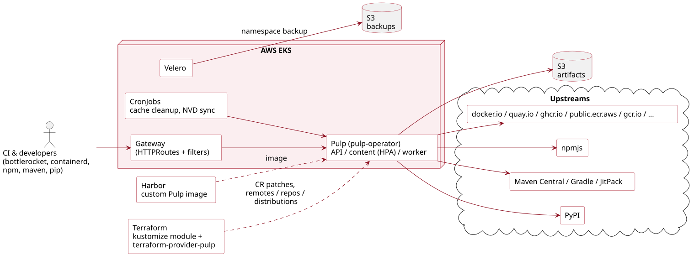
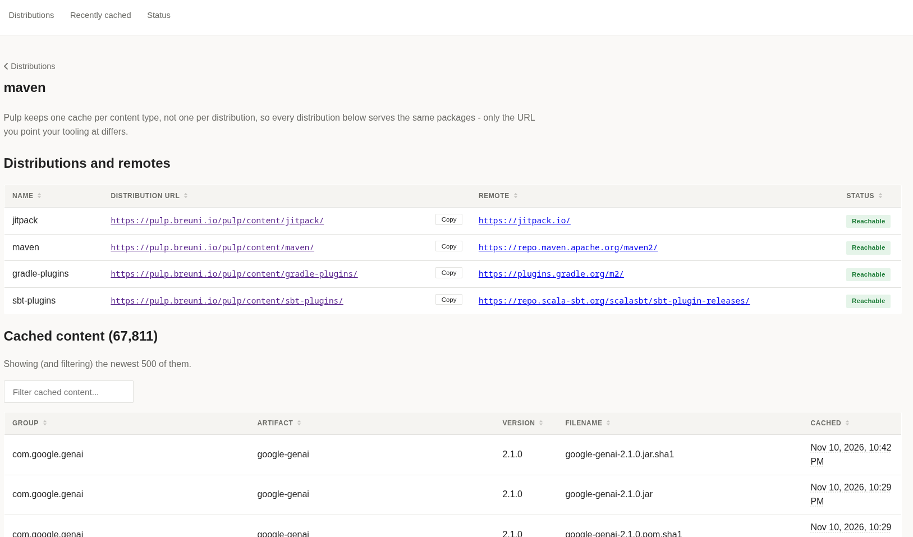

[.title]
= How we replaced Sonatype Nexus with Pulp at Breuninger
Josef Müller - E. Breuninger GmbH & Co

:revealjs_theme: white
:customcss: custom.css
:revealjs_history: true
:revealjs_slideNumber: c/t
:icons: font
:revealjs_totalTime: 1560
:source-highlighter: highlight.js
:revealjs_transition: slide

:revealjs_width: 1200

:revealjs_pdfseparatefragments: false

== Agenda

. Where we came from: Nexus
. Why we switched and what we needed
. Our Pulp stack
. Hacks we needed on the way 😉
. Where we are now

[.inverted]
== Where we came from

== Nexus

[.logos]

 +  + 

[.notes]
--
_~1:30_

* Nexus was a *pull-through cache* only:
** OCI: docker.io, public.ecr.aws
** npm
** Maven: Maven Central, Gradle plugins, JitPack
* Maven had a *grouped transparent endpoint*: one URL, and whichever upstream holds the artifact serves it.
* *No private repositories* in Nexus. Private artifacts live in GitLab's package registries.
--

[.notes]
--
_~0:45_

* One pod, no scaling. If it was down, every build was down.
* The configuration was imperative: a bash script calling the REST API. Nobody liked touching it.
--

== Sonatype Nexus license change

. Sunset of OSS
. Either use CE with limits or use Pro

[.notes]
--
_~0:45_

* The licence change took away the plain "free OSS" path we relied on.
* Being honest: we hadn't updated it for two years. That alone was a reason to rebuild it properly.
--

== What we needed

* Open source
* Free
* Self-hostable
* Pull-through for OCI, npm and Maven

[.fragment]
-> *Pulp*

[.notes]
--
_~0:45_

Pulp ticks all four boxes. Bonus: Python and other content types come with it.
--

[.inverted]
== Our Pulp stack

== Architecture

[.notes]
--
_~1:30_

* Pulp runs on AWS EKS, deployed by the pulp-operator.
* Artifacts live in an S3 bucket.
* Our own gateway sits in front of Pulp. Many hacks later in this talk live there as HTTPRoute filters.
* CronJobs do the jobs Nexus did natively (cleanup, NVD mirror).
--

== Deployment details

[%step]
* Pulp Operator without the backup/restore CRDs
* Pulp CRD patched using Kustomize and Terraform
* Custom Pulp image with forks of patched plugins
* HPA on the content pods + Nodepool
* Configured using `terraform-provider-pulp`

== Testing

* Spin up a kind cluster (cloud-kind provider + Terraform)
* GarageHQ as S3 replacement
* Run real pull-throughs:
** npm, Python, Maven
** OCI: docker.io, quay.io, ghcr.io, public.ecr.aws
* Automatic rollouts to production

[.inverted]
== Configuration, learnings & hacks during migration 😉

== Pulp as pull-Through cache

[%step]
* Pulp is primarily used as pull-through cache
* Private packages are hosted on our Gitlab
* File repositories are used for boot images, switch configurations and NVD

== `terraform-provider-pulp`

[source,hcl]
----
resource "pulp_remote" "docker" {
  name         = "docker"
  url          = "https://registry-1.docker.io"
  content_type = "container"
  plugin_name  = "pull-through"
  policy       = "on_demand"
}

resource "pulp_distribution" "docker" {
  name        = "docker"
  base_path   = "docker"
  plugin_name = "pull-through"
  remote      = pulp_remote.docker.pulp_href
}
----

Remotes, repositories and distributions as code. Written with Claude.

[.notes]
--
_~1:00_

* Everything is declarative and reviewed in merge requests.
* I wrote the provider with Claude.
--

== Anonymous OCI pull-through

Pulp didn't support anonymous pull-through caching until recently.

* Dummy user with permissions:
** `containerpullthroughdistribution_consumer`
** `containernamespace_consumer`
* Gateway injects `Authorization: Basic <base64>` on `/v2/`

[.notes]
--
_~1:30_

* Nexus served anonymously, and every client in the company relied on that. Asking everyone to configure credentials would have blocked the migration.
* So the gateway adds the dummy user's credentials before the request reaches Pulp.
* Requests that already carry credentials pass through unchanged.
--

////
== Cleanup

* CronJob: remove content *older than 180 days*
* Only from repositories with a *cache label*
* Pulp has no "last pulled" timestamp
** so we delete regardless of usage 🤷

[.notes]
--
_~1:00_

* Without cleanup the S3 bucket only grows.
* Downside: popular packages get evicted too and are fetched from upstream again on the next pull.
* A "last downloaded" attribute in Pulp would let us do usage-based eviction. Feature request!
--

////

== Limitations of the npm plugin

[cols="1,1",frame=none,grid=none]
|===
a|*Tarball URLs aren't rewritten*

[source,json]
----
"resolved": "https://registry.npmjs.org/
  left-pad/-/left-pad-1.3.0.tgz"
----

`package-lock.json` points at npmjs +
-> `npm ci` bypasses Pulp

-> *patched plugin fork*
a|*No `npm audit`*

[source,text]
----
POST /-/npm/v1/security/advisories/bulk
----

Pulp doesn't implement the endpoint

-> gateway sends a *307* to `registry.npmjs.org`
|===

[.notes]
--
_~1:30_

* Lockfiles: npm stores the tarball URL from the package metadata in the lockfile. Pulp passed the upstream metadata through unchanged, so every lockfile pointed at npmjs. CI uses `npm ci`, so in practice CI didn't use the cache at all. That's why the custom image with patched plugin forks exists.
* Audit: the gateway silently redirects audit requests to npmjs. A 307, not a 301/302: the client must repeat the POST with the same body.
--

== Rate limited by Maven Central

* Maven tries its repositories one after another
* Pulp got requests for artifacts that *Maven Central doesn't have either*
* Every request -> 404 upstream -> Maven tries the next repository

-> Temporary switch to another remote and a fix of the ci maven configurations helped

[.notes]
--
_~1:30_

* The root cause was the clients' Maven configuration, not Pulp.
* With the grouped Nexus endpoint the fan-out was hidden. With Pulp, each miss became a request to Central.
* Many builds × many misses = rate limited.
--

== OCI: subdomains -> subpaths

[cols="1,1",frame=none,grid=none]
|===
a|*Nexus*

`docker.nexus.breuni.io` +
`public-ecr.nexus.breuni.io` +
_one subdomain per registry_
a|*Pulp*

`pulp.breuni.io/docker` +
`pulp.breuni.io/ecr` +
`pulp.breuni.io/ghcr`
|===

[.fragment]
Fine for buildah. Harder for containerd, Talos and Bottlerocket.

[.notes]
--
_~1:00_

* One subdomain per registry doesn't scale: DNS, certificates, and gateway config for every new upstream.
* Subpaths scale, but the tools that use containerd (Talos, Bottlerocket) have their own opinions about paths.
--

== The `/v2/` shuffle

[cols="1,2",frame=none,grid=none]
|===
|`override_path = false`
|containerd doesn't add `/v2/`

|`override_path = true`
|`pulp.breuni.io/docker/<name>/v2/…` ❌

|Pulp expects
|`pulp.breuni.io/v2/docker/<name>/…` ✅
|===

-> An HTTPRoute filter moves `/v2/` to the front.

[.notes]
--
_~1:30_

* containerd's mirror config can't produce the path Pulp needs.
* Instead of fighting every client, the gateway normalizes the path.
* Clients can use whichever form their tool produces.
--

[.inverted]
== Current state

== Pulp in numbers

[cols="1,1",frame=none,grid=none]
|===
a|[.big]#~1-2M#

requests / day
a|[.big]#70,000#

cached artifacts
|===

++++

  
  

++++

[.notes]
--
_~0:45_

* Graphs: Loki, sliding `count_over_time` over 24h, so the y-axis is *requests per day*.
* First graph: all Pulp pods by status. *302 beats 200*: most downloads are redirects to S3, Pulp never streams the bytes.
* Second graph (next click): the 302s by distribution. Maven dominates, then npm.
* The dips are weekends.
--

////
== Not only a cache

[source,text]
----
pulp.breuni.io/pulp/content/image/<version>/
  initrd.img        120.6 MB
  rootfs.squashfs   744.5 MB
  vmlinuz            19.0 MB
----

* Our bare-metal nodes PXE-boot a *bootc maintenance image*
* CI builds it and uploads it with `pulp-cli` into a *file repository*
* matchbox serves `vmlinuz` + `initrd.img` from Pulp, dracut fetches `rootfs.squashfs` over HTTPS

[.notes]
--
_~1:00_

* Pulp isn't only a pull-through cache for us. It also distributes things we build ourselves.
* One directory per version, so a node's boot profile pins an exact build and rollback is changing one variable.
* Same S3 bucket, same gateway, same Terraform provider for the repository and the upload user. No extra file server.
--

////

== Pulp UI

Read-only

[.notes]
--
_~1:00_

* Developers asked: "Which URL do I use?" and "Is my package cached?". The API answers that, but nobody wants to curl it.
* Shows distributions with their URLs and remotes, whether the upstream is reachable, and the recently cached content.
* Read-only, no write path to Pulp. Three env vars to run it.
* Not the official Pulp UI, a much simpler tool for our developers. Also written with Claude Code.
--

== Takeaways

[%step]
* It's a good product. We'd do it again!
* Pulp works as a company-wide pull-through cache, and ships our own boot images
* The Operator is great!
* Every gap had a fix: a route, a fork or a CronJob. *Because it's open source.*
* Consistent API -> Terraform provider, UI and CI uploads on top

[%step]
-> Thanks to the Pulp maintainers

[.notes]
--
_~1:30_

* I picked on Pulp a lot today. That's the useful part to share, not a verdict.
* None of the problems was a dead end. With Nexus we'd have been waiting for a vendor; here we could read the code and fix it.
* Things we'd love upstream: last-pulled timestamp, npm tarball URL rewriting, npm audit passthrough.
* Thank the Pulp maintainers and the community.
--

== Questions?

[.notes]
--
Remaining time for questions.
--
